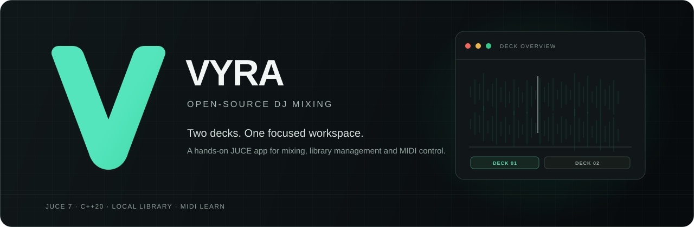
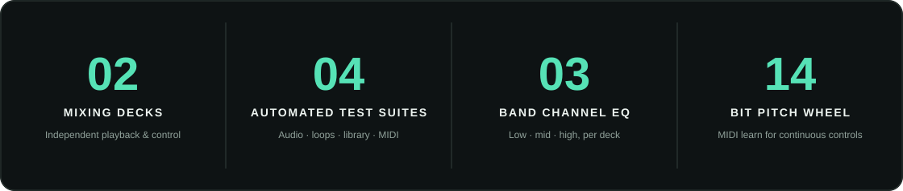

<div align="center">



<br>

[](LICENSE)


**A local-first, open-source DJ mixing application built with C++20 and JUCE.**

[Features](#features) · [Build](#build) · [MIDI controllers](docs/CONTROLLERS.md) · [Architecture](docs/ARCHITECTURE.md) · [Roadmap](ROADMAP.md) · [Contributing](CONTRIBUTING.md)

</div>

> **Development status:** Vyra is an actively developed foundation for a two-deck DJ application. It is not yet a replacement for mature commercial DJ systems. See [current limitations](#current-limitations) before using it for a performance.

<p align="center">
  
</p>

## Features

### Mix and perform

- **Two independent decks** with asynchronous track loading, playback, cue, seek, and overview waveforms.
- **Waveform navigation:** click or drag the compact deck overviews to seek; double-click to load a different track.
- **Performance controls:** three saved hot cues per track, 1/2/4/8-beat loops, four-beat jumps, tempo estimates, pitch/speed adjustment, and one-shot deck sync.
- **Channel processing:** three-band EQ, resonant filter, echo, channel gain, and per-deck level meters.
- **Master section:** equal-power crossfader, master gain, peak limiter, and output meter.
- **WAV recording:** record the master output to 24-bit stereo WAV, with pause and resume.
- **Headphone cue:** pre-fader deck monitoring and cue/master mix when the audio device provides four or more outputs.

### Organize your library

- Import folders into a **local SQLite music library** with embedded metadata and cached waveforms.
- Search tracks and organize them into named playlists.
- Browse recently played tracks, including tracks loaded directly from disk.
- Analyze BPM and musical key when metadata is not available. These automatic estimates are useful starting points, not verified beat grids.

### Connect a controller

- Select any MIDI input exposed by the operating system; create custom mappings with MIDI Learn.
- Map transport buttons with MIDI notes, faders and knobs with 7-bit CC, and continuous controls with 14-bit pitch bend.
- Control play, cue, hot cues, loops, beat jumps, sync, headphone cue, pitch, EQ, filters, echo, crossfader, and master gain.
- Save and restore mappings as validated JSON. A few starter profiles are included; device-level support varies.

See [MIDI controller setup, profiles, and limitations](docs/CONTROLLERS.md). Listed controllers have not all been tested with physical hardware.

## Build

### Requirements

- CMake 3.22 or later
- A C++20 compiler and native desktop/audio development toolchain
- Git and network access for the initial configure (to fetch pinned dependencies)

Vyra pins JUCE 7.0.12. To use an installed JUCE CMake package instead, set `-DVYRA_USE_SYSTEM_JUCE=ON`.

### Windows (PowerShell)

```powershell
cmake -S . -B build -DCMAKE_BUILD_TYPE=Release
cmake --build build --config Release
ctest --test-dir build -C Release --output-on-failure
```

### Linux and macOS

```sh
cmake -S . -B build -DCMAKE_BUILD_TYPE=Release
cmake --build build --config Release
ctest --test-dir build --output-on-failure
```

The application executable is placed under `build/Vyra_artefacts/Release/` (Windows: `Vyra.exe`).

## Current limitations

- Two-deck operation only; four decks are not implemented.
- Pitch changes both playback speed and pitch; key lock and time stretching are not implemented.
- BPM and key are automatic estimates; editable beat grids and beat-aligned sync are not implemented.
- MIDI jog support is a relative seek nudge, not scratch emulation. HID, controller LED feedback, and DVS/timecode are not implemented.
- Supported audio formats depend on the JUCE build and enabled format modules.
- Available audio backends, device routing, and latency depend on the platform and device drivers. No specific latency or controller-hardware compatibility is guaranteed.
- Discord Rich Presence is optional and communicates with the local Discord desktop client when enabled.

## Project layout

| Path | Contents |
|---|---|
| `app/src/audio`, `app/include/vyra/audio` | Audio engine, DSP, analysis, and mixing math |
| `app/src/library`, `app/include/vyra/library` | SQLite library and track management |
| `app/src/ui`, `app/include/vyra/ui` | Desktop interface and deck controls |
| `app/src/integrations` | MIDI controller and Discord integrations |
| `tests` | Focused audio, loop, library, and controller test suites |
| `docs/ARCHITECTURE.md` | Component boundaries and real-time audio considerations |
| `docs/CONTROLLERS.md` | MIDI Learn instructions, starter profiles, and limitations |
| `ROADMAP.md` | Planned work and project status |

## License

Vyra is distributed under **GPL-3.0-only**; see [`LICENSE`](LICENSE). JUCE 7.0.12 is pinned to maintain license compatibility. Review the licenses and codec terms of dependencies before enabling or distributing them.

## Contributing

Bug reports, feature requests, tests, and documentation contributions are welcome. See [`CONTRIBUTING.md`](CONTRIBUTING.md); please include reproducible steps and your operating system/audio device for audio issues.
